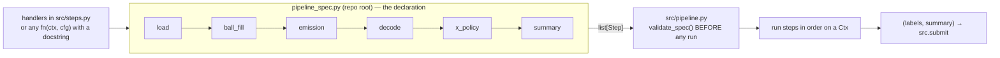

# PIPELINE STANDARD — AI agent edition (MTAH 2027, LA+AI)

**Audience:** AI agents (and humans who want the full contract) working in this repository.
**Companion document:** [`PIPELINE_STANDARD.html`](./PIPELINE_STANDARD.html) — the human-facing
summary; that one wins on wording if the two ever disagree about *intent*, this one wins on
*technical detail*.
**Status:** v1.0, 2026-11-08, on branch `framework/pipeline-spec`, pending team review before
merging to `main`.

---

## 1. Purpose

The team works in parallel branches, each pursuing a different "break" that might improve the
score. This framework makes those branches **diffable and swappable**: the whole pipeline is a
declared list of stages in one file, so an experiment is a one-line binding change instead of a
cross-cutting edit through the audited core.

It is an **experimentation standard, not an adoption shortcut** — see §7 (change process) and §8
(invariants).

## 2. Architecture



| File | Role |
|---|---|
| `pipeline_spec.py` (root) | **The declaration.** The one file edited to swap / reorder / add stages. |
| `src/pipeline.py` | Contract (`Ctx`, `Step`, `validate_spec`) + runner (`run`). |
| `src/steps.py` | The six default handlers: thin adapters over the existing pure stage functions. |
| `tests/test_pipeline_spec.py` | Framework tests (validation, ordering, swap mechanics). |
| `PIPELINE_STANDARD.html` / `_AI.md` | The standard, human and AI editions. |

## 3. Contract

### 3.1 `Ctx` (the data tray)

| Field | Set by (default) | Meaning |
|---|---|---|
| `arrays` | `load` | Match arrays from `src.data.load_arrays()` (ATD, players, homography, graded spans). |
| `track` | `ball_fill` | `BallTrack` with provenance tiers. |
| `emission` | `emission` | Per-frame H/A/D log-emission + confidence. |
| `decoded` | `decode` | Decoder result (labels, reverted switches). |
| `labels` | `x_policy` | Final `np.int8` label array for all 199,319 frames. |
| `summary` | `summary` | Run summary dict (segment stats, gating, coverage). |
| `extra` | any step | Free-form `dict` for experimental steps — use this instead of adding ad-hoc top-level fields. |

### 3.2 `Step`

```python
Step(name: str, fn: Callable[[Ctx, dict], None],
     requires: tuple[str, ...] = (), provides: tuple[str, ...] = ())
```

* `name` — unique within the spec.
* `fn(ctx, cfg) -> None` — reads inputs from `ctx`, stores results back. `cfg` is the `config.CFG`
  dict (or a test override).
* `requires` — `Ctx` fields that must already be present (provided by an earlier step).
* `provides` — `Ctx` fields this step guarantees after it runs.

### 3.3 Validation (runs **before** any step executes)

`validate_spec(spec) -> list[str]` (empty list = valid) rejects:

| Condition | Error names |
|---|---|
| `requires` not satisfied by any earlier step's `provides` | the step + missing fields |
| `fn` has no docstring (empty/absent `__doc__`) | the step + the function |
| duplicate `name` | the step |

`run()` raises `ValueError` listing all problems, or — if validation passes but the run never
produced `labels`/`summary` — a clear end-state error. **Docstring enforcement is deliberate:**
every step must document itself; a handler without a docstring will not run.

### 3.4 `run`

```python
labels, summary = run(cfg)                # default: pipeline_spec.SPEC
labels, summary = run(cfg, spec=my_spec)  # explicit spec (tests, experiments)
```

Backward compatible with the pre-framework signature `run(cfg)`; callers `src/submit.py` and
`tests/test_submission.py` are unchanged.

## 4. Recipes

### 4.1 Swap a stage (e.g. ViT instead of the current gap fill)

```python
# pipeline_spec.py — on your branch
from src.vit_fill import ball_track          # fn(ctx, cfg) -> None, WITH a docstring

SPEC = [
    Step("load",      S.load,       provides=("arrays",)),
    Step("ball_fill", ball_track,   requires=("arrays",), provides=("track",)),   # ← swapped
    # … rest unchanged …
]
```

### 4.2 Add a stage

```python
# src/my_stage.py
def postprocess(ctx, cfg):
    """One line saying what this stage does (required)."""
    ctx.extra["my_metric"] = ...

# pipeline_spec.py
SPEC = [ ..., Step("postprocess", postprocess,
                   requires=("labels",), provides=("summary")) ]   # or any fields you declare
```

Insert it wherever its `requires` are satisfied; `validate_spec` will tell you if the position is
wrong — before anything runs.

### 4.3 Test a custom spec without running the full pipeline

Toy specs are the pattern (see `tests/test_pipeline_spec.py`): provide `labels` and `summary`
directly from tiny handlers, assert runner behaviour in milliseconds. Do **not** spin full-pipeline
runs for framework tests — the end-to-end equivalence of the *default* spec is already enforced
once, by `tests/test_submission.py`.

## 5. Invariants (never break these)

1. **Default output is frozen.** The default `SPEC` must reproduce `LA+AI.csv` byte-for-byte:
   md5 `0ed725f70f4a230cd50ee9023dda60b6`. Enforced by
   `test_committed_submission_is_what_the_code_produces`.
2. **Tests green after every commit** (currently 92).
3. **No fitting/tuning/selecting** on the provided match, its ground truth, the video, or the
   public window. External evidence only (IDSSE), and scoring-behaviour changes require
   **>0.02 paired on IDSSE, pre-declared in `dossier.md` §7** — never adopted on taste.
4. **Never edit** `evaluation/`, `starter/`, `games.py`. **Never commit** `data/*`. **Never
   weaken** `.gitignore`. **Never rewrite or force-push** history.
5. **Byte-identical regeneration** after every kept change that alters output (regenerate the CSV
   in the same commit).
6. **Stage functions stay pure and untouched** by framework work — `tuning/` and
   `src/diagnostics.py` call them directly and must keep working unchanged.

## 6. Documentation requirements (enforced socially, by this standard)

* Every `fn` in a spec carries a docstring (machine-enforced, §3.3).
* The spec file's module docstring stays the quick-start for humans.
* Any change to **this standard** updates **both** documentation editions in the same commit.

## 7. REQUIRED: change process for the standard itself

**Any change to the common framework — contract, runner, validation rules, defaults, docs — must
be shared with the rest of the team before it merges.** This is an adoption requirement, not a
courtesy: a framework change nobody knows about breaks the shared standard.

For an AI agent proposing or implementing such a change:

1. **Work on a branch** off `main`; never edit the contract on `main` directly.
2. **Verify before proposing:** full suite green (`pytest -q`), fresh
   `python -m src.submit --out /tmp/v.csv` + `md5sum` — byte-identical unless the change is
   *intended* to alter behaviour, in which case stop: behaviour changes follow §8's evidence rule
   instead, and the framework change may only be the *mechanism*, never the *tuning*.
3. **Write the proposal for humans:** what changed, why, the diff, verification output. Keep it
   short enough to read in the team chat.
4. **Share it** (team chat and/or the Wednesday 11-11 sync). Do not merge to `main` / the final
   branch before the team has seen it.
5. **Merge only after the team agrees.** The Wednesday meeting is the adoption checkpoint.
6. **Update both doc editions** (`PIPELINE_STANDARD.html` + this file) in the same commit as the
   change.

Swapping a handler *within your own branch* is **not** a framework change and needs no process —
that is what the framework is for.

## 8. What the framework does not do

* It does not bypass the evidence rule (§5.3). Plug-and-play on a branch ≠ adoption in the final
  branch.
* It does not replace P6: the evaluator band / E-series gates remain the yardstick for comparing
  which team member's approach actually scores better.
* It does not touch `config.py` provenance: every `CFG` key still needs its origin entry
  (`tests/test_config.py`).
* It does not provide a local-overlay/CLI-selection mechanism in v1 — the committed spec is the
  single source of truth so any clone reproduces the same output. (Deliberate anti-overengineering
  choice; revisit only via §7.)

## 9. Coming next (not built now)

A common **results-sharing & improvement-proposal framework** so the Wednesday sync runs on shared
result cards and written proposals. Out of scope for v1; will be designed *after* this standard is
adopted, via the same §7 process.

## 10. Verification commands

```bash
.venv/bin/python -m pytest -q                    # must be green (92 tests)
rm -f /tmp/v.csv
.venv/bin/python -m src.submit --out /tmp/v.csv  # official validator must PASS
md5sum /tmp/v.csv                                # 0ed725f70f4a230cd50ee9023dda60b6
```
